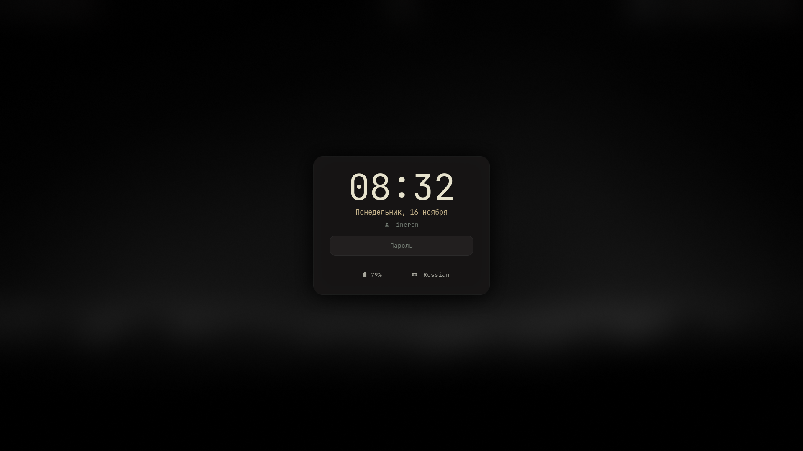

# Inerium Shell

<p align="center">
  <a href="https://github.com/ineron01/inerium-shell/actions/workflows/ci.yml"></a>
  <a href="https://github.com/ineron01/inerium-shell/releases/latest"></a>
  <a href="LICENSE"></a>
  <a href="https://archlinux.org"></a>
  <a href="https://www.rust-lang.org/"></a>
</p>

[English](README.md) | [Русский](README.ru.md)

Universal CachyOS / Arch Linux desktop environment built around **Hyprland (Lua API)**, **Waybar**, **Rofi**, **Mako**, **SwayOSD**, **Dolphin KIO**, and a native **Rust / GTK4** utility suite themed in the **Inerium Dragon** palette.



---

## Repository Structure

```
inerium-shell/
├── assets/                  # Default wallpapers, preview showcases, and greeter background
├── config/                  # Symlinkable desktop configurations (~/.config/*)
├── crates/                  # Unified Rust workspace suite
│   ├── dolphin-converter/   # Fast document/media converter CLI with ONNX background removal
│   ├── inerium-camera/      # High-performance virtual webcam manager (Android to /dev/video0)
│   ├── inerium-greeter/     # Lightweight GTK4 login screen and session picker for greetd
│   ├── inerium-hw/          # Dynamic sysfs hardware discovery & battery/thermal telemetry
│   ├── inerium-i18n/        # Bilingual localization catalog (Russian / English)
│   ├── inerium-polkit/      # Native GTK4/Relm4 Polkit authentication agent
│   ├── inerium-setup/       # GTK4 onboarding wizard, display calibration & sign-ins
│   ├── inerium-shell/       # GTK4 / Layer Shell control center and Relm4 popups
│   └── inerium-tools/       # Waybar telemetry daemons, IPC bridges & cooling regulator
├── docs/                    # Illustrated guides, keybindings, and module runbooks
├── first-login.d/           # Onboarding sign-in steps (GitHub CLI, Google Drive rclone)
├── hardware/                # Patched MSI EC DKMS kernel driver supporting Bravo 15 C7VE
├── local/                   # User executables (~/.local/bin/) and Dolphin KIO servicemenus
├── scripts/install/         # Modular installation phases (00-helpers through 70-summary)
├── system/                  # System-wide udev rules, greetd configs, and systemd units
├── bootstrap.sh             # One-command TTY bootstrap installer
└── install.sh               # Universal idempotent orchestrator (--bin, --from-source)
```

---

## Installation & Quick Start

### 1. One-Line Bootstrap (Recommended)

Works identically from a **fresh TTY** or **inside any existing desktop environment** (KDE Plasma, GNOME, etc.):

**Short URL (via GitHub Pages):**
```bash
curl -sL ineron01.github.io/inerium-shell | bash
```

**Direct GitHub Raw URL (Alternative / Fallback):**
```bash
bash -c "$(curl -fsSL https://raw.githubusercontent.com/ineron01/inerium-shell/main/bootstrap.sh)"
```

- **Interactive TUI:** Auto-detects hardware (GPU, laptop battery/chassis, existing Display Manager) and offers quick choices.
- **Fast prebuilt binaries (Default):** Downloads compact release archives (~6 MB) directly from GitHub Releases, skipping heavy Cargo compilation.
- **Smart Fallback:** Automatically falls back to local source build if dynamic shared libraries mismatch.
- **Preserves existing DE:** When installed on top of KDE/GNOME, it sets Inerium (`Hyprland (UWSM-Waybar)`) as the default session in `greetd` while keeping KDE Plasma untouched and available to launch.

### 2. Silent / Automated Run (for scripts or SSH)

```bash
bash -c "$(curl -fsSL https://raw.githubusercontent.com/ineron01/inerium-shell/main/bootstrap.sh)" -- -y
```

### 3. Source Compilation & Developer Mode

Clones directly into `~/inerium-shell` (visible in your home directory) and compiles via Cargo:

```bash
bash -c "$(curl -fsSL https://raw.githubusercontent.com/ineron01/inerium-shell/main/bootstrap.sh)" -- --from-source
```

> **Target Paths & Overrides:**
> - Standard prebuilt bootstrap installs to `$XDG_DATA_HOME/inerium-shell` (default: `~/.local/share/inerium-shell`, hidden to keep `$HOME` clean).
> - Source compilation installs to `~/inerium-shell` (visible for easy access to source code).
> - You can override the clone path anytime with `INERIUM_SHELL_DIR=/custom/path`.

### 4. Local Run from Cloned Repo

```bash
git clone https://github.com/ineron01/inerium-shell.git ~/inerium-shell
cd ~/inerium-shell
./install.sh --bin --with-greeter --with-gdrive
```

---

## Documentation & Guides

- **[Hotkeys, Gestures & Waybar Tutorial](docs/keybindings.md)** ([Русская версия](docs/keybindings.ru.md)) — Complete guide for system navigation, window tiling, shortcuts, touchpad gestures, and Waybar interactive features.
- **[Optional Modules & Add-ons Guide](docs/addons.md)** ([Русская версия](docs/addons.ru.md)) — Detailed documentation for Inerium Camera, MSI Cooling (`msi-ec` DKMS + fan regulator), and noVPN split-tunneling.
- **[Android Phone Webcam Setup](docs/camera-setup.md)** ([Русская версия](docs/camera-setup.ru.md)) — One-time ADB setup instructions for using a smartphone as a Linux webcam.

---

## Optional System Add-ons

Inerium Shell provides optional system extensions that can be selected in the installer TUI or passed via CLI flags:

- `--with-gdrive`: **Google Drive Integration** — Background `rclone` user service mount for cloud storage access in Dolphin.
- `--with-converter`: **Dolphin Converter** — Context menu audio, video, document, and PDF converter with optional AI background removal (`silueta.onnx`).
- `--with-camera`: **Inerium Camera** — Turns an Android phone into a high-definition webcam (`/dev/video0`) with GTK4 GUI, dynamic switching (back/front/laptop), and portrait/landscape support.
- `--with-msi-ec`: **MSI Cooling & Fan Regulator** — Upstream `msi-ec-dkms-git` kernel driver + dynamic CPU/GPU thermal curve regulator daemon (`msi-fan-regulator`).
- `--with-novpn`: **noVPN Split-Tunneling** — Run specific applications directly through physical network interfaces bypassing any active VPN.
- `--all-addons`: Installs all optional add-ons together.
- `--uninstall`: **Clean Uninstaller** — Disables registered user/system services, removes all deployed symlinks, binaries, and templates based on the installation manifest (`~/.local/state/inerium/install-manifest`), and removes `~/.local/share/inerium-shell` (leaving any custom paths untouched).
- `--prune`: **Prune Obsolete Files** — Scans and removes obsolete files from previous versions against the installation manifest.

---

## First-Login Onboarding (`inerium-setup`)

On first login, `inerium-setup` launches an interactive GTK4 wizard allowing you to:
- Adjust display scaling, resolution, and refresh rate.
- Select your preferred wallpaper and layout preferences.
- Connect GitHub CLI and Google Drive via integrated terminal widgets.

Re-run anytime from the application launcher or by running `inerium-setup`.
