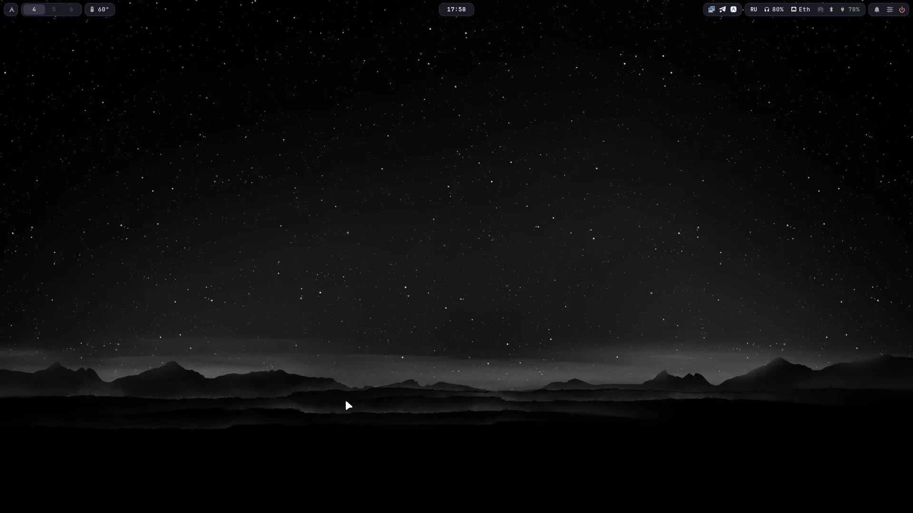
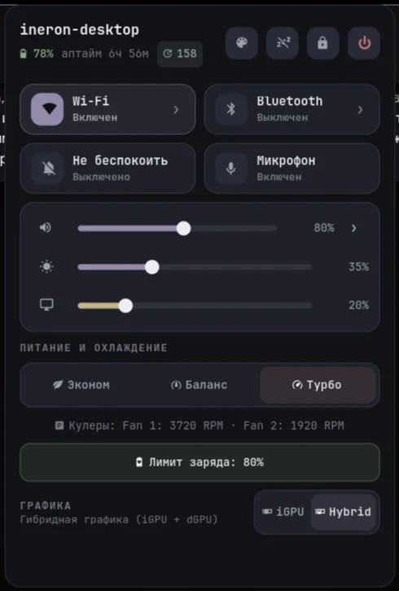
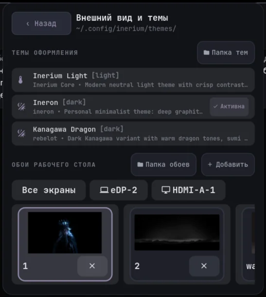
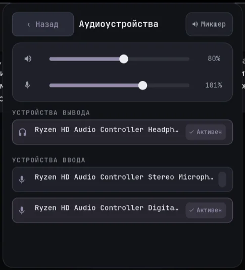
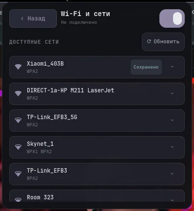
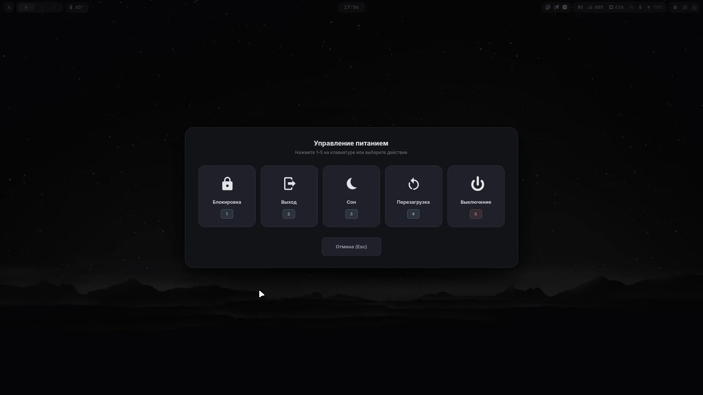
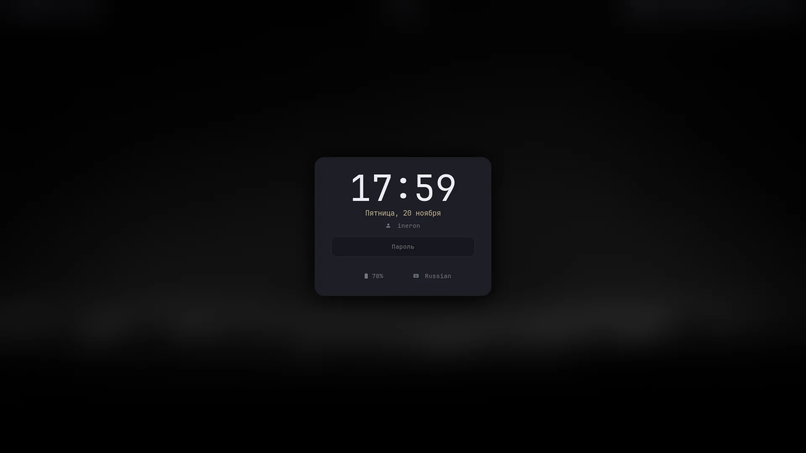

# Inerium Shell

<p align="center">
  <a href="https://github.com/ineron01/inerium-shell/actions/workflows/ci.yml"></a>
  <a href="https://github.com/ineron01/inerium-shell/releases/latest"></a>
  <a href="LICENSE"></a>
  <a href="https://archlinux.org"></a>
  <a href="https://www.rust-lang.org/"></a>
</p>

[English](README.md) | [Русский](README.ru.md)

Универсальное окружение рабочего стола для CachyOS / Arch Linux, построенное вокруг **Hyprland (Lua API)**, **Waybar**, **Rofi**, **Mako**, **SwayOSD**, **Dolphin KIO** и нативного набора утилит на **Rust / GTK4** в фирменной цветовой палитре **Inerium Dragon**.

<p align="center">
  
</p>

<p align="center">
  
  
  
</p>
<p align="center">
  
  
  
</p>

> [!NOTE]
> На скриншотах демонстрации используется персональная тема оформления разработчика (**Ineron**). По умолчанию Inerium Desktop поставляется с палитрой **Inerium Dragon**, а также включает готовые палитры сообщества (`inerium-theme list --all`).

---

## Структура репозитория

```
inerium-shell/
├── assets/                  # Обои по умолчанию, снимки витрины и фоны экрана входа
├── config/                  # Разворачиваемые конфигурации по манифесту (~/.config/*)
├── crates/                  # Единый воркспейс утилит на Rust
│   ├── dolphin-converter/   # Конвертер медиа и документов для Dolphin с AI-удалением фона
│   ├── inerium-camera/      # Менеджер виртуальной веб-камеры (Android ADB/Wi-Fi в /dev/video0)
│   ├── inerium-greeter/     # Экран входа greetd на GTK4 с выбором сессий
│   ├── inerium-hw/          # Модуль автоопределения железа и телеметрии sysfs
│   ├── inerium-i18n/        # Каталог двуязычной локализации (RU / EN)
│   ├── inerium-polkit/      # Нативный Polkit-агент аутентификации на GTK4/Relm4
│   ├── inerium-setup/       # Графический мастер настройки экранов и авторизаций
│   ├── inerium-shell/       # Центр управления и интерактивные Relm4-попапы
│   ├── inerium-theme/       # Движок тем оформления, генератор палитр и компилятор токенов
│   └── inerium-tools/       # Демоны телеметрии Waybar, IPC-мосты и контроль кулеров
├── docs/                    # Иллюстрированные руководства, горячие клавиши и инструкции
├── first-login.d/           # Шаги первичной авторизации (GitHub CLI, Google Drive, No-VPN маршрутизация)
├── local/                   # Пользовательские скрипты (~/.local/bin/) и меню Dolphin KIO
├── scripts/install/         # Модульные стадии установки (00-helpers .. 70-summary)
├── system/                  # Системные udev-правила, greetd и юниты systemd
├── themes/                  # Базовые цветовые палитры (Kanagawa Dragon, Inerium Light) и пул themes/extra/
├── bootstrap.sh             # Однострочный TTY-бутстраппер
└── install.sh               # Универсальный оркестратор установки (--bin, --from-source)
```

---

## Способы установки и быстрый старт

### 1. Однострочный бутстрап (рекомендуется)

Работает одинаково как из **чистой TTY-консоли**, так и **внутри любого существующего графического окружения** (KDE Plasma, GNOME и др.):

**Короткий URL (через GitHub Pages):**
```bash
curl -sL ineron01.github.io/inerium-shell | bash
```

**Прямой URL GitHub Raw (рекомендуемый):**
```bash
bash -c "$(curl -fsSL https://raw.githubusercontent.com/ineron01/inerium-shell/main/bootstrap.sh)"
```

- **Интерактивный TUI:** автоматически определяет оборудование (GPU, батарею/шасси ноутбука, установленный дисплейный менеджер) и предлагает быстрый выбор компонентов.
- **Быстрые предсобранные бинарники (по умолчанию):** загружает компактные релизные архивы (~6 МБ) напрямую из GitHub Releases без долгой компиляции через Cargo.
- **Умный откат (Smart Fallback):** автоматически переключается на локальную сборку из исходников при несовместимости динамических библиотек.
- **Сохранение существующего окружения:** при установке поверх KDE/GNOME настраивает Inerium (`Hyprland (UWSM-Waybar)`) сессией по умолчанию в `greetd`, сохраняя KDE Plasma нетронутой и доступной для запуска.

### 2. Тихая / автоматическая установка (для скриптов и SSH)

```bash
bash -c "$(curl -fsSL https://raw.githubusercontent.com/ineron01/inerium-shell/main/bootstrap.sh)" -- -y
```

### 3. Сборка из исходников

Клонирует репозиторий в `~/inerium-shell` (видимая папка в домашней директории) и компилирует крейты через Cargo:

```bash
bash -c "$(curl -fsSL https://raw.githubusercontent.com/ineron01/inerium-shell/main/bootstrap.sh)" -- --from-source
```

> **Расположение репозитория и пути установки:**
> - Стандартная установка бинарников выполняется в `$XDG_DATA_HOME/inerium/shell` (по умолчанию `~/.local/share/inerium/shell`, скрытая папка — не захламляет `$HOME` и защищена от случайного удаления).
> - Сборка из исходников размещает репозиторий в `~/inerium-shell` (видимая директория в `$HOME` для удобного просмотра и редактирования кода).
> - Файлы конфигурации: Устанавливаются как реальные файлы прямо в `$XDG_CONFIG_HOME` (`~/.config/{hypr,waybar,kitty,rofi,mako,uwsm,gtk-3.0,gtk-4.0}`) и регистрируются в манифесте (`~/.local/state/inerium/install-manifest`), избавляя систему от хрупких симлинков каталогов. Пользовательские настройки сохраняются при обновлениях; для обновления конфигов используется флаг `--update-configs` с автоматическим созданием бэкапов `.bak.<timestamp>`.
> - Темы и палитры: Базовые темы размещаются в `~/.config/inerium/themes/` (`kanagawa-dragon.toml`, `inerium-light.toml`, `template.toml.example`), а каталог дополнительных тем доступен в `~/.local/share/inerium/themes/extra/`.
> - Бинарные файлы: Пользовательские утилиты ставятся в `~/.local/bin/`, а экран входа — в `/usr/local/bin/inerium-greeter`.
> - Путь к репозиторию можно переопределить переменной: `INERIUM_SHELL_DIR=/любой/путь`.

### 4. Локальный запуск из клонированного репозитория

```bash
git clone https://github.com/ineron01/inerium-shell.git ~/inerium-shell
cd ~/inerium-shell
./install.sh --bin --with-greeter --with-gdrive
```

---

## Документация и руководства

- **[Руководство по горячим клавишам, жестам и Waybar](docs/keybindings.ru.md)** ([English version](docs/keybindings.md)) — Полное иллюстрированное руководство по управлению системой, тайлингу окон, шорткатам, жестам тачпада и скрытым возможностям панели Waybar.
- **[Руководство по дополнительным модулям](docs/addons.ru.md)** ([English version](docs/addons.md)) — Подробная документация по Inerium Camera, охлаждению MSI (`msi-ec` DKMS + регулятор кулеров) и noVPN.
- **[Настройка смартфона для Inerium Camera](docs/camera-setup.ru.md)** ([English version](docs/camera-setup.md)) — Пошаговая инструкция по настройке смартфона через ADB для работы в режиме веб-камеры.

---

## Дополнительные системные модули и параметры установщика

Inerium Shell включает опциональные расширения, которые можно выбрать в TUI установщика или включить через флаги командной строки:

### Флаги модулей (Add-ons)
- `--with-gdrive`: **Google Drive Integration** — Фоновая служба `rclone` для удобного доступа к Google Диску в файловом менеджере Dolphin.
- `--with-converter`: **Dolphin Converter** — Конвертер аудио, видео, документов и изображений из контекстного меню Dolphin с опциональным ИИ-вырезанием фона (`silueta.onnx`).
- `--with-camera`: **Inerium Camera** — Использование Android-смартфона как 1080p веб-камеры (`/dev/video0`) с графическим интерфейсом GTK4, горячим переключением камер и поддержкой портретного/альбомного форматов.
- `--with-msi-ec`: **Модуль ядра MSI** — Пропатченный драйвер ядра `msi-ec-dkms-git` для управления лимитом батареи и узлами платформы ноутбуков MSI.
- `--with-fan-regulator`: **Регулятор охлаждения MSI** — Системный демон автоматической регулировки кулеров CPU/GPU (`msi-fan-regulator`) по акустическим кривым (требует железо MSI).
- `--with-novpn`: **noVPN Split-Tunneling** — Прямой запуск выбранных приложений через физический сетевой шлюз в обход активного VPN.
- `--with-github`: **GitHub CLI Integration** — Установка GitHub CLI (`gh`) и регистрация шага первичной авторизации для `git push` и подписи коммитов.
- `--all-addons`: Установка всех доступных дополнительных модулей одновременно.

### Флаги конфигурации и управления
- `--update`: Быстрое обновление существующей установки (сохраняет установленные модули и настройки без повтора вводных вопросов).
- `--sysupgrade`, `-Syu`: Выполнить полное обновление операционной системы (`pacman -Syu`) вместе с обновлением Inerium Shell (по умолчанию обновление быстрое и точечное, затрагивает только Inerium и недостающие зависимости).
- `--bin`: Установка готовых скомпилированных бинарников из GitHub Releases (по умолчанию).
- `--rolling`: Использование новейших rolling-сборок бинарников из GitHub Releases (с автоматическим фолбэком на `rolling` при обновлении динамических библиотек и смене ABI в Arch Linux).
- `--from-source`: Локальная компиляция Rust-воркспейса через Cargo.
- `--with-greeter`: Установка и настройка дисплейного менеджера `greetd` + экрана входа `inerium-greeter`.
- `--lang [en|ru]`: Выбор языка установщика и базовой локали системы.
- `--workspaces N`: Число виртуальных рабочих столов на монитор (1-9, по умолчанию: 3).
- `--fetch-model`: Загрузка ИИ-модели удаления фона `silueta.onnx` (~43 МБ).
- `--update-ui`: Обновление только компонентов оформления и оболочки (Waybar, Rofi, темы, анимации; пользовательские бинды и правила окон не затрагиваются).
- `--update-configs[=all|ui]`: Обновление конфигурационных файлов (значение `ui`: только темы и панели; значение `all`: все конфиги с сохранением измененных пользователем файлов в бэкапы `.bak.<timestamp>`).
- `--restore-assets`, `--restore-defaults`: Восстановление стандартных обоев и тем оформления (при обновлении; удаленные пользователем обои по умолчанию не восстанавливаются).
- `--check-abi`: Проверка корректности зависимостей динамических библиотек (`ldd`) для всех установленных бинарников.
- `--prune`: Очистка устаревших файлов относительно предыдущего манифеста установки.
- `--dry-run`: Вывод планируемых действий без модификации системы.
- `--non-interactive`, `-y`: Автоматическая установка без интерактивных диалогов TUI.
- `--uninstall`: **Чистое удаление** — Отключает зарегистрированные службы, удаляет все разложенные симлинки, бинарники и шаблоны по манифесту установки (`~/.local/state/inerium/install-manifest`), а также удаляет `~/.local/share/inerium/shell` (и legacy `~/.local/share/inerium-shell`, сохраняя пользовательские конфигурации в `~/.config/` для работоспособности сессии Hyprland и не затрагивая каталоги разработчика).

---

## Первичная настройка (`inerium-setup`)

При первом входе в сессию запускается графический мастер `inerium-setup` (GTK4):
- Калибровка мониторов, частоты обновления и масштабирования.
- Выбор обоев и стилей интерфейса.
- Авторизация в GitHub CLI и Google Drive во встроенных терминалах без лишних окон.

Повторный запуск доступен в любое время из лаунчера или командой `inerium-setup`.


---

## Темы оформления и кастомизация (Theme Engine)

Inerium Desktop включает декларативный движок и компилятор тем оформления (`inerium-theme`), работающий по принципу Single Source of Truth.

### Базовые темы из коробки
- **Inerium Light (`inerium-light`)**: Чистая современная нейтральная светлая тема с высокой контрастностью, белыми карточками (`#ffffff`), глубоким слейт-текстом (`#1e293b`) и стандартной дневной температурой дисплея 6500K.
- **Kanagawa Dragon (`kanagawa-dragon`)**: Тёмная палитра на основе японских чернил суми-э с тёплыми тонами и мягкими акцентами.

### Адаптивный Центр Управления
- **Кнопка оформления (`󰏘`) в шапке**: Нажатие ЛКМ открывает полнофункциональную вкладку **Темы и обои**. Нажатие ПКМ мгновенно переключает оформление между тёмным и светлым режимами (dark ↔ light).

### Создание пользовательской темы
Создайте TOML-файл темы в каталоге `~/.config/inerium/themes/<id>.toml`. Создать подробный шаблон с подсказками можно командой:
```bash
inerium-theme new <id>
```
Или вручную. Парсер поддерживает универсальные форматы (`#hex`, `rgb(...)`, `rgba(...)`, `rgb(r g b / a)`) и автоматически вычисляет промежуточные состояния, обводки и цвета ползунков, если они не указаны:

```toml
[theme]
id = "my-custom-theme"
name = "My Custom Theme"
author = "Ваше Имя"
upstream = "https://github.com/your-username/my-theme"
variant = "dark" # "dark" или "light" (управляет системным переключателем темы GTK)
license = "MIT"
description = "Краткое описание вашей палитры"

[typography]
font_ui = "Inter"                       # Шрифт интерфейса (GTK, попапы, Waybar, Rofi, Mako)
font_mono = "JetBrainsMono Nerd Font"   # Моноширинный шрифт (терминал Kitty, редакторы)
font_size = 11.0                        # Базовый размер шрифта (в пунктах)

[palette]
# Базовые фоновые слои (RGB или RGBA)
bg_canvas         = "rgba(24, 22, 22, 0.97)"
bg_surface        = "#221f1f"
# Дополнительные слои (вычисляются автоматически, если опущены)
bg_surface_alt    = "#1c1a1a"
bg_surface_hover  = "#2d2a2a"
bg_surface_active = "#363434"

# Рамки окон и разделители
border_subtle     = "rgba(197, 201, 197, 0.10)"
border_active     = "#87a987"           # Основная обводка активного окна
border_active_secondary = "#8ba4b0"     # Второй цвет 45° градиента рамок Hyprland

# Цвета текста
text_primary      = "#c5c9c5"
text_heading      = "#e6e2cc"
text_muted        = "#737c73"
text_subtle       = "#a6a69c"
text_inverted     = "#181616"

# Цвета шкал в Центре управления
slider_fill       = "#87a987"           # Шкалы громкости и яркости экрана ноутбука
slider_fill_secondary = "#c4b28a"       # Шкала яркости внешнего монитора DDC/CI

# Акцентные цвета
accent_primary    = "#87a987"
accent_green      = "#87a987"
accent_blue       = "#8ba4b0"
accent_amber      = "#c4b28a"
accent_red        = "#c4746e"
accent_aqua       = "#8ea4a2"
accent_purple     = "#8992a7"

shadow            = "rgba(0, 0, 0, 0.85)"
modal_backdrop    = "rgba(18, 16, 16, 0.48)"
slider_trough     = "rgba(197, 201, 197, 0.10)"
slider_thumb      = "#e6e2cc"

[display]
temperature = 6500 # Цветовая температура экрана в Кельвинах (6500 для нейтрального дня, 5500 для бумаги)
```

### Каталог дополнительных тем (`themes/extra/`)
Помимо двух основных базовых тем, Inerium содержит коллекцию популярных палитр сообщества, доступных для активации в один клик в мастере `inerium-setup` или через `inerium-theme install <id>` (что навсегда переносит палитру в `~/.config/inerium/themes/`):
- **Kanagawa Lotus (`kanagawa-lotus`)**: Тёплая палитра состаренной японской бумаги (автор rebelot) с автоматическим переключением дисплея в мягкие 5500K.
- **Kanagawa Wave (`kanagawa-wave`)**: Классическая тёмная палитра морских глубин (автор rebelot).
- **Tokyo Night (`tokyo-night`)**: Неоновая тёмная киберпанк-палитра (автор folke).
- **Catppuccin Mocha (`catppuccin-mocha`)**: Тёмная пастельная палитра.
- **Catppuccin Latte (`catppuccin-latte`)**: Светлая пастельная палитра.
- **Nord (`nord`)**: Спокойная арктическая сине-холодная палитра.
- **Gruvbox Dark (`gruvbox-dark`)**: Тёплая ретро-палитра в земляных тонах.
- **Dracula (`dracula`)**: Контрастная палитра в фиолетовых тонах.

Шаблон для создания собственной темы доступен в `~/.config/inerium/themes/template.toml.example`.

### Команды CLI
- `inerium-theme new <id>` — Создать чистый шаблон темы с подробнейшими комментариями в `~/.config/inerium/themes/<id>.toml`.
- `inerium-theme watch [id]` — Режим Live Watch: отслеживает сохранение файла и мгновенно перекомпилирует и применяет тему на лету.
- `inerium-theme preview <id>` — Быстрый просмотр любой темы из пула extra без её копирования.
- `inerium-theme list` — Показать активные темы (`--all` — показать все включая дополнительные, `--json` — машинный вывод).
- `inerium-theme set <id>` — Применить тему по её идентификатору (автоматически скопирует из extra, если нужно).
- `inerium-theme install <id>` — Перенести тему из дополнительных в постоянные (`~/.config/inerium/themes/`) и применить.
- `inerium-theme toggle` — Быстрое переключение между светлой и тёмной темой.
- `inerium-theme reload` — Перезагрузить и повторно применить активную тему из текущей конфигурации.
- `inerium-theme current` — Вывести идентификатор текущей активной темы.
- `inerium-theme status` — Вывести метаданные текущей активной темы в формате JSON.

### Пользовательские хуки (`~/.config/inerium/hooks.d/`)
Любой исполняемый файл или скрипт в `~/.config/inerium/hooks.d/` автоматически запускается при смене темы и получает вариант (`dark` или `light`) и идентификатор темы первым и вторым аргументами.

---

## Лицензия и атрибуция

Inerium Shell распространяется под лицензией [GNU General Public License v3.0 or later](LICENSE) (GPL-3.0-or-later).

- Крейт `crates/inerium-polkit` содержит код, основанный на `soteria` (распространяется под лицензией Apache-2.0, см. `crates/inerium-polkit/LICENSE` и `NOTICE`).

